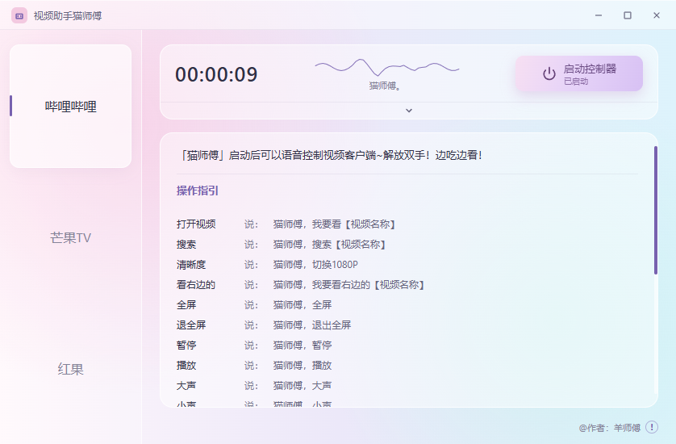
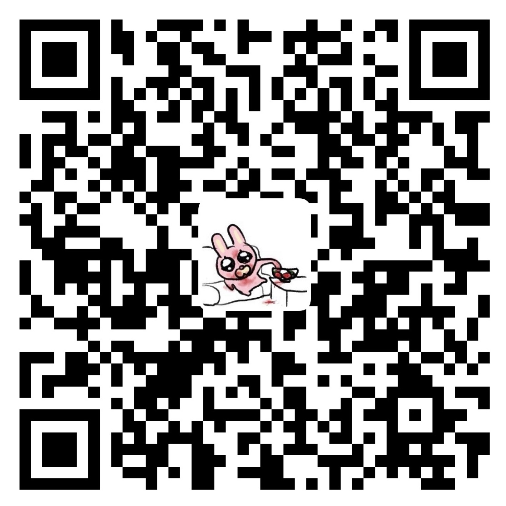

# 视频助手猫师傅 (=^･ω･^=)

双手腾不出来的时候，喊一声猫师傅，让它帮你控制正在看的视频，这样就可以一边吃炸鸡一边刷视频啦，不用油手摸键鼠。

它是一只住在 Windows 上的语音小助手。说话在你自己的电脑上听，不往外传。打开控制器后，先喊「猫师傅」，再说要干什么。

## 怎么用 (｡•ᴗ•｡)

不会自己打包也没关系。做好的客户端在 [dist/视频助手.exe](dist/视频助手.exe)，下载下来直接打开。

1. 打开视频助手，也打开哔哩哔哩或芒果TV。
2. 点右上角的【启动控制器】。按钮变成「已启动」，声波线开始轻轻动，就说明它在听了。
3. 对着麦克风说，例如：
  - 「猫师傅，我要看【视频名称】」
  - 「猫师傅，全屏」
  - 「猫师傅，暂停」
  - 「猫师傅，关闭当前视频」

同一时间只听一个视频软件。左边可以切换标签看看说明，真正在听的是你点过启动的那一个。关掉这个小窗口，猫师傅就下班，不再听了。

说得含糊一点也没关系。「高师傅」「小猫」「猫猫」它也认。具体说法都写在窗口里的操作指引上，照着念就好。

## 现在能管谁 (๑•̀ㅂ•́)و✧

| 客户端  | 状态   |
| ---- | ---- |
| 哔哩哔哩 | 可以喊它 |
| 芒果TV | 可以喊它 |
| 红果   | 待开发  |
| 抖音   | 待开发  |

## 给作者塞点零食

你的鼓励，就是我持续迭代的动力，给作者来个 6.6 吧！

| 支付宝                                  | 微信                                  |
| ------------------------------------ | ----------------------------------- |
|  |  |

## 想一起玩

合作、反馈、或者想先聊聊红果和抖音怎么接，都可以来找羊师傅。

- 邮箱：[yezi.yang@outlook.com](mailto:1026524727@qq.com)
- 微信：Nightingaleeeeee
- 小红书：羊某又在刮

