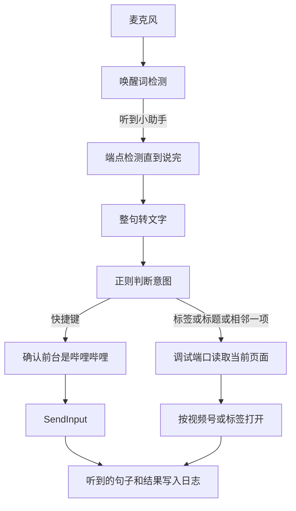

# 视频助手技术设计

| 项 | 内容 |
| --- | --- |
| 文档状态 | 按 2026-10-27 的方案评估改写 |
| 运行环境 | Windows 10 及以上，Python 3.11 |
| 控制对象 | 已安装的哔哩哔哩 Windows 客户端（Electron） |
| 关联文档 | [需求文档.md](需求文档.md) |

交互以 [需求文档.md](需求文档.md) 为准。模块划分、模型、阈值和失败时停在哪一步，以本文为准。

本版只控制这个哔哩哔哩客户端。抖音、红果不进入实现。

## 1. 要完成的交互

用户对着麦克风说「小助手」，再说一句不必一字不差的话。助手把后半句转成文字，判断意图，只操作哔哩哔哩。

| 用户在说的事 | 助手要做成的事 |
| --- | --- |
| 暂停、播放、全屏、音量 | 把客户端叫到前台，发送它自己的快捷键 |
| 切到直播、切到推荐 | 在当前页面里找到这个标签并打开 |
| 我要看「一天极限逛吃汕头」这类标题 | 在当前已经画出来的视频卡片里按标题匹配，打开对应稿件 |
| 下一个视频、上一个视频 | 在包含当前稿件的那份已渲染列表里打开相邻一项 |

卡片是竖排还是平铺，读页面的方式相同。读到的是标题和视频号，不是屏幕坐标。

## 2. 总链路



平时只跑唤醒。没听到「小助手」，不转写、不操作。听到之后才把这一句送去识别。

## 3. 模块

代码按这四个文件拆。每个文件只做一类事，`main.py` 负责把结果串起来。

| 文件 | 模块 | 用的技术 |
| --- | --- | --- |
| `main.py` | 主窗口与调度 | CustomTkinter |
| `voice_rec.py` | 收音、唤醒、说完判定、转文字 | sounddevice，sherpa-onnx |
| `command_parser.py` | 意图与标题比对 | 正则，rapidfuzz，pypinyin |
| `bilibili_controller.py` | 窗口、快捷键、页面读取 | pywin32，SendInput，Chrome 调试端口 |

### 3.1 主窗口：`main.py`

用来完成启动检查和启动/断开。用户看视频时不回到窗口核对，所以听到的句子、匹配到的标题和失败原因不展示在窗口上，只写入日志 `assist.log`。有托盘图标，用 pystray 实现，与 CustomTkinter 主循环分线程运行。关闭窗口只最小化到托盘；托盘菜单是显示主窗口、启动/断开、退出，只有从托盘菜单退出才结束进程并放开麦克风。

用 CustomTkinter。窗口内容少，不需要浏览器壳；它比系统自带 tkinter 容易做成稳定的小窗口，又不必引入 Qt。

窗口布局以需求文档为准：左侧哔哩哔哩、抖音、红果三个标签，默认哔哩哔哩，抖音和红果盖灰色蒙层。右侧控制页面自上而下是【启动控制器】按钮、必要项检查区、【打开配置】。

点击【启动控制器】后逐项检查四项必要项：哔哩哔哩客户端已通过调试端口启动（客户端在运行，且调试端口可连接）、麦克风设备已识别、麦克风权限可用、语音识别模型已下载。任一不通过显示【启动失败】和重试标识，不通过项右侧显示修复按钮：客户端项是【重启哔哩哔哩】（流程见第 3.4 节），麦克风设备项是【重新检测】（重新枚举输入设备并重试打开默认麦克风），麦克风权限项是【打开权限设置】（打开系统麦克风隐私设置页 `ms-settings:privacy-microphone`，用户开启后自动重查该项），模型项是【重新下载】（重新下载模型文件到模型目录）。修复按钮完成后只重查该项，重试标识重查全部。四项全部通过才进入已启动并读麦克风。已启动时再次点击按钮即断开，`voice_rec.py` 不再读麦克风。检查结果展示在检查区；语音执行的结果只写日志。不向用户解释调试端口的概念，所有修复逻辑内置在按钮里。

### 3.2 语音：`voice_rec.py`

这个模块把麦克风里的声音变成一句文字，不理解这句话要做什么。

分三步，三步用同一套 sherpa-onnx，模型都在本机：

1. **唤醒。** 模型 `sherpa-onnx-kws-zipformer-wenetspeech-3.3M-2024-01-01`。它只判断音频里有没有「小助手」，计算量小，适合一直开着。默认词可在配置里改，改完下次启动再生效。
2. **说完判定。** 唤醒之后用 sherpa-onnx 自带的 Silero VAD。它判断哪一段是人声、哪一段已经停了，把这一句切出来。停顿阈值默认 700 毫秒，最长一句 8 秒，防止标题很长时被截断，也防止一直不结束。
3. **转文字。** 模型 `sherpa-onnx-sense-voice-zh-en-ja-ko-yue-int8-2024-07-17`。对切好的这一句做离线识别，输出简体中文。SenseVoice 面向中文短句，int8 量化后的模型文件约 240 MB，适合标题这种专有名词。

采样是默认麦克风、单声道、16000 Hz。音频只留在内存，识别完就丢。模型放在 `%APPDATA%\VideoAssist\models\`，本地没有时才下载，下载的是模型文件，不是用户的录音。

麦克风打不开时，「麦克风设备已识别」「麦克风权限可用」对应的检查项打叉，进入启动失败，按第 3.1 节的修复按钮处理。已启动后麦克风中途断开时，停止监听并记入日志，不自动重连。

唤醒和这句话连在一起说时，唤醒命中前约 1.5 秒的音频留在内存环形缓冲里，连同后面的人声一起送去转写，避免「小助手我要看……」的后半句丢词。缓冲不落盘。

### 3.3 意图与标题比对：`command_parser.py`

这个模块只处理文字。输入是转写结果，输出是下面之一：

| 意图 | 参数 | 什么时候判成它 |
| --- | --- | --- |
| `toggle_play` | 无 | 含「暂停」「播放」「继续」 |
| `fullscreen` | 无 | 含「全屏」 |
| `volume` | `up` / `down` / `mute` | 含「大声」「音量加」「小声」「音量减」「静音」 |
| `switch_tab` | 标签原文，如「直播」 | 「切到 / 打开 / 看」后面是已知标签名 |
| `adjacent` | `next` / `previous` | 含「下一个」「下一条」「上一个」「上一条」，或整句就是要看相邻一项 |
| `open_title` | 去掉口头语之后的标题 | 「看 / 播放 / 打开 / 我要看」后面剩下的是标题 |
| `unknown` | 无 | 对不上 | 

同一句里按这个顺序判，先命中先停：`switch_tab`、`adjacent`，然后才是 `toggle_play`、`fullscreen`、`volume`，最后才是 `open_title`。这样「我要看下一个视频」不会被当成标题「下一个视频」，「切到直播」也不会被拿去和视频卡片比对。

`open_title` 不在这里决定开哪一条。它只把标题交给控制模块。控制模块拿回当前页面的卡片之后，再用 rapidfuzz 做两路分数，取高的一路：

- 汉字相似度
- 拼音相似度。拼音用 pypinyin 转成不带声调的音节再比

第二路用来接住听写错误，例如「逛吃」听成「逛街」。最高分低于 `0.72`，或者前两名相差小于 `0.05`，就不开视频，把听到的句子和最接近的标题记入日志。阈值放在配置里。

### 3.4 客户端控制：`bilibili_controller.py`

这个模块执行意图。它里面是两条互不替代的路。

#### 快捷键

用来做播放、暂停、全屏、音量。这些动作客户端已经绑了键，不需要读页面。

用 pywin32 找窗口，用 `SendInput` 送键。不用 pygetwindow：窗口标题是中文，那层封装容易对不齐句柄。不用 pyautogui：它移动的是系统鼠标，没有「当前前台是不是哔哩哔哩」这道检查。

窗口规则：

- 进程映像名是 `哔哩哔哩.exe`，比较时不区分大小写。本机同时有多个同名进程，只认带标题的顶层窗口。
- 多个候选时，取可见、未最小化、面积最大的那个。都最小化时，取带标题的那个并还原。
- 置前：必要时 `ShowWindow(SW_RESTORE)`，当前线程挂到前台线程和目标线程上，再 `SetForegroundWindow`。
- 置前之后再读一次前台进程。映像名仍是 `哔哩哔哩.exe` 才发送按键。否则停止，记入日志。

键用虚拟键加扫描码发送，描述在配置里，不写死在分支里。本机 2026-10-26 对照已安装客户端 `E:\Program Files\bilibili\哔哩哔哩.exe` 的快捷键表核对：

| 意图 | 键 | 虚拟键 | 客户端行为 |
| --- | --- | --- | --- |
| 播放 / 暂停 | 空格 | `VK_SPACE` 0x20 | 播放与暂停互切 |
| 音量加 | ↑ | `VK_UP` 0x26 | 音量增加 10% |
| 音量减 | ↓ | `VK_DOWN` 0x28 | 音量减少 10% |
| 静音 | M | `VK_M` 0x4D | 静音开关 |
| 全屏 | F | `VK_F` 0x46 | 全屏开关 |
| 多 P 上一个 | `[` | `VK_OEM_4` 0xDB | 只切换分 P |
| 多 P 下一个 | `]` | `VK_OEM_6` 0xDD | 只切换分 P |

`[` 和 `]` 不用于「推荐里的下一个」或平铺卡片。客户端没有给这两种界面绑快捷键。空格是切换键，已经暂停时再说「暂停」会变成播放；助手不读取播放器内部状态。

焦点若停在客户端的搜索框或弹幕框里，空格会进输入框。助手无法从外面判断焦点在不在输入框里，这种情况在结果里无法区分，只能再喊一次或先让播放器重新获得焦点。

#### 页面读取

用来做三件事：切换标签、按标题打开卡片、打开当前列表的上一项或下一项。

哔哩哔哩客户端是 Electron，界面是页面。平铺卡片、右侧列表、顶部的「推荐」「直播」，只要已经画出来，就在页面节点里，节点上有文字；视频卡片还有 BV 号或 av 号。调试端口读的是这些节点，所以排版是网格还是一列没有区别。

连接方式：客户端以 `--remote-debugging-port` 启动，助手只连 `127.0.0.1` 上的这个端口。先请求 `/json` 列出页面目标，包括主页面和 `<webview>` 里的客页面，再走 Chrome DevTools Protocol。用标准库发 HTTP，用 `websockets` 接调试通道。

读到的每张卡片只保留三样：可见标题、视频号、是否在当前视口里。没滚到、还没渲染的卡片不在页面里，读不到，也不去猜。

执行方式：

- **标签。** 找可见文字与标签名一致的节点，调用它的点击。找不到就停止，记入日志。被收进「更多」里的标签，页面上没有节点，同样失败。
- **标题。** 用第 3.3 节的分数在已渲染卡片里选一条。选中后按视频号打开稿件，不按屏幕坐标点击。
- **相邻一项。** 先找包含当前正在播放的视频号的那一份已渲染列表，再打开它的前一项或后一项。当前稿件不在任何已渲染列表里，就停止，记入日志。不用 `[` `]` 去猜。

客户端没在运行，或调试端口不可连接时，客户端检查项不通过。用户点击【重启哔哩哔哩】：客户端在运行时先弹确认，确认后正常结束所有 `哔哩哔哩.exe` 进程；然后用可执行文件路径附加 `--remote-debugging-port=<debug_port>` 启动，等端口可连接后重新检查该项。客户端没在运行时不弹确认，直接启动。路径优先取运行中进程的可执行文件路径，取不到时用配置里的 `client_path`。除这个按钮外，助手不启动、不重启、不结束任何客户端进程。

## 4. 评估后不放进主路径的做法

这些做法讨论过，主路径不使用。写在这里是为了实现时不再混进来。

| 做法 | 不放进主路径的原因 |
| --- | --- |
| SpeechRecognition 的在线识别 | 音频会离开本机。这个库若使用，只能被误解成录音工具，容易接错到 Google |
| SpeechRecognition 的音量断句 | 视频声音一大就会把句子截断，或把视频声当成用户在说话。断句改由 Silero VAD 做 |
| 全程 faster-whisper，不做唤醒 | 中文标题要用更大的模型才稳，而且旁边说话也会被转写。唤醒和转写都放在 sherpa-onnx 里，依赖更集中 |
| fuzzywuzzy + python-Levenshtein | 库已停止维护。rapidfuzz 接口同类且更快。只比汉字编辑距离时，听错一个同音字就会失败，所以同时比拼音 |
| PaddleOCR 加坐标点击 | 安装重，滚动、缩放和 DPI 一变坐标就偏。主路径读到视频号后直接打开 |
| pyautogui | 操作的是真实鼠标，前台若不是哔哩哔哩，点击会落到别的程序 |
| 把标题贴进搜索框再搜 | 打开的是全站搜索结果，不是当前页面上的那张卡片 |
| 系统媒体键 | 会作用到系统当前的媒体会话，客户端自己也没注册全局媒体键 |
| 后台 `PostMessage` 投递按键 | Electron 播放器不按这套消息暂停 |

页面读取若在本机证实接不上，这一版的标签、标题和相邻项就失败并记入日志。不自动改成截图点击。

## 5. 配置

`%APPDATA%\VideoAssist\config.json`。第一次没有这个文件就写入默认内容。之后用户改过的文件，程序不覆盖。

```json
{
  "wake_word": "小助手",
  "endpoint_silence_ms": 700,
  "max_utterance_ms": 8000,
  "match_threshold": 0.72,
  "match_margin": 0.05,
  "debug_port": 9222,
  "tabs": ["推荐", "直播"],
  "process": "哔哩哔哩.exe",
  "client_path": "",
  "keys": {
    "toggle_play": ["space"],
    "fullscreen": ["f"],
    "volume_up": ["up"],
    "volume_down": ["down"],
    "mute": ["m"]
  }
}
```

无法识别的键名视为这份快捷键无效，记入日志，不发送未知扫描码。`client_path` 为空时，从运行中的客户端进程取可执行文件路径，用于【重启哔哩哔哩】。日志在同目录 `assist.log`，只记意图、听到的文字、匹配到的标题、成功或失败原因。不记音频。

## 6. 边界

- 语音识别不出本机。唯一的网络行为是本机还没有模型时下载模型。
- 按键只在前台进程确认为 `哔哩哔哩.exe` 之后发送。
- 调试端口只连接本机，只对这个客户端的页面发读节点和打开稿件的命令。不把调试端口暴露到局域网。
- 助手只在用户点击【重启哔哩哔哩】后才动客户端进程：客户端在运行时须经确认再结束并重启，没在运行时直接以调试端口启动。除此之外不启动、不重启、不结束任何进程。
- 配置里不执行任意命令。

## 7. 尚未在本机证实的前提

快捷键和进程名已经在 2026-10-26 核对过。下面两条还没有：

1. 官方客户端是否接受 `--remote-debugging-port=9222`，以及「推荐」「直播」和视频卡片是否都在可连接的页面目标里。
2. SenseVoice 对用户真实口误的标题，配上拼音分数后，`0.72` 是否够用。不够就调配置，不改执行路径。

第 1 条不成立时，快捷键仍然可以做；标签、按标题打开、相邻一项按第 4 节停住，不改走坐标点击。

## 8. 实现顺序

1. 用命令行对已打开的哔哩哔哩置前并发送空格，确认前台检查有效。
2. 用调试端口列出页面目标，打印当前可见卡片的标题和视频号，以及「推荐」「直播」节点在不在。这一步决定页面能力是否成立。
3. 接上唤醒、断句和转写，听到的句子写入日志。
4. 把意图接到快捷键和页面操作上，补上没听清、分数不够、端口没开这几种结果。
